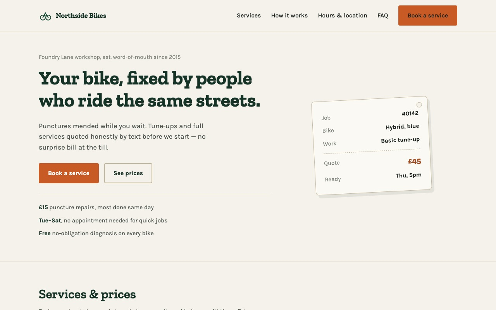

# Northside Bikes

A one-page landing site for a fictional bicycle repair &amp; servicing shop, built as a Fiverr portfolio piece for local-business web design.

**Live:** https://marven151.github.io/northside-bikes/



## What's on the page

- Sticky header with nav and a "Book a service" call to action
- Hero section with a receipt-style job ticket as the visual anchor
- Services &amp; price list (punctures, tune-ups, full services, e-bikes, wheel truing, new bike builds, collection)
- "How a repair works" — drop off, quote by text, pick up
- Opening hours, fictional address, and an embedded OpenStreetMap map
- FAQ built with native `<details>`/`<summary>` accordions
- A booking form (name, email, bike type, service, date, message) with client-side validation and a success message — it's a demo, so nothing is actually sent anywhere
- Footer with a clear "demo project" note

## Stack

Plain HTML, CSS and vanilla JavaScript. No build step, no frameworks, no dependencies beyond two Google Fonts (Zilla Slab and Karla).

## Run locally

```bash
git clone https://github.com/Marven151/northside-bikes.git
cd northside-bikes
python3 -m http.server 8000
# open http://localhost:8000
```

## Note

Northside Bikes is not a real business. The name, address, prices and reviews implied on this page are invented for demonstration purposes only.

## License

MIT — see [LICENSE](LICENSE).
